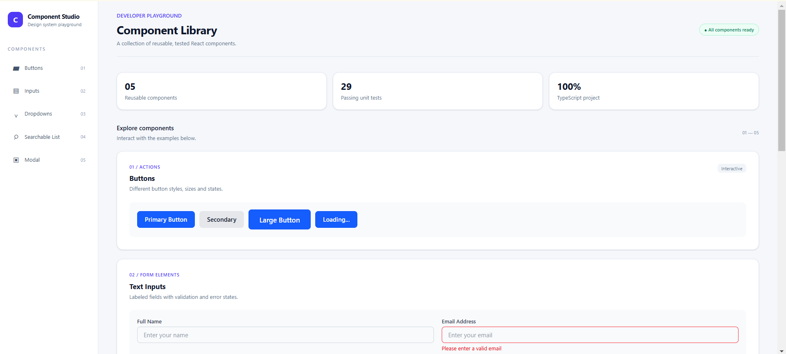
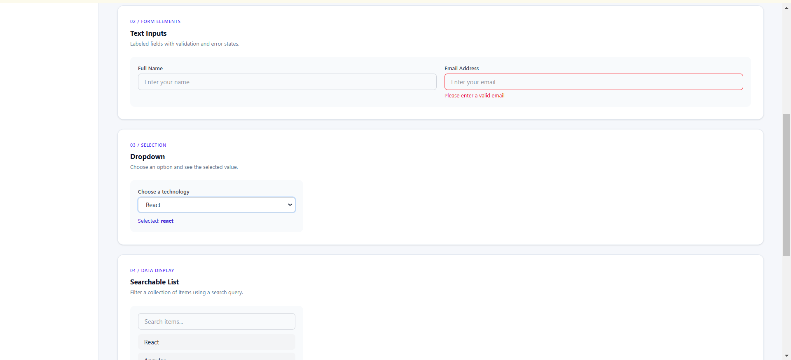
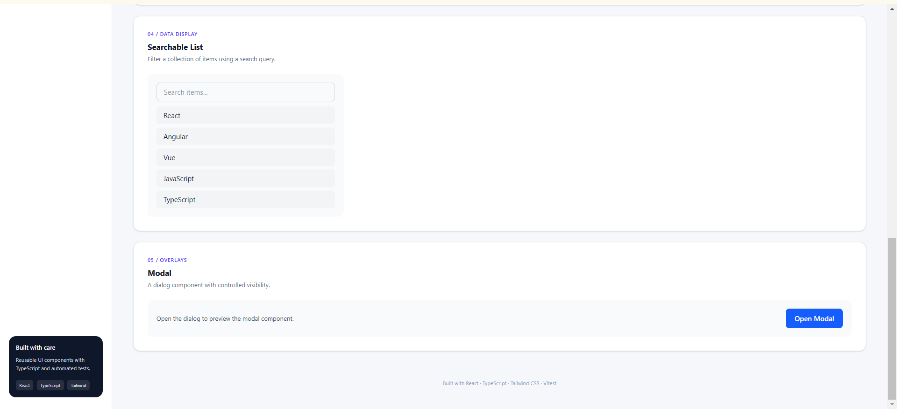

# React Component Studio

A collection of reusable, interactive UI components built with **React, TypeScript and Tailwind CSS**. This project demonstrates component architecture, reusable design patterns, UI development and component testing.

## Overview

React Component Studio is a frontend component library featuring reusable components with configurable properties, interactive states and automated tests.

## Screenshots

### Component Studio Overview


### UI Components


### Interactive Components


## Components

| Component | Features |
|---|---|
| Button | Variants, sizes, loading and disabled states |
| Input | Labels, placeholders, disabled and error states |
| Modal | Controlled visibility, close actions and backdrop interaction |
| Dropdown | Configurable options, selection and error states |
| Searchable List | Case-insensitive filtering and customizable empty states |

## Tech Stack

- React
- TypeScript
- Tailwind CSS
- Vite
- Vitest
- React Testing Library
- Jest DOM
- User Event

## Testing

The project includes **29 automated tests across five test files**.

Test coverage includes:
- Component rendering
- User interactions
- Props and state handling
- Disabled and loading states
- Input validation and error states
- Filtering and selection behaviour

Run tests:

```bash
npm install
npm run test -- --run
```

## Getting Started

Clone the repository:

```bash
git clone https://github.com/febafrancis-dev/react-typescript-components.git
```

Navigate into the project:

```bash
cd react-typescript-components
```

Install dependencies:

```bash
npm install
```

Start the development server:

```bash
npm run dev
```

Open the local URL provided by Vite.

## Production Build

```bash
npm run build
```

## Project Structure

```text
src/
├── components/
│   ├── Button/
│   ├── Input/
│   ├── Modal/
│   ├── Dropdown/
│   └── SearchableList/
├── test/
│   └── setup.ts
├── App.tsx
├── index.css
└── main.tsx
```

## Purpose

This project was developed to demonstrate practical frontend engineering skills, including reusable component development, TypeScript, responsive UI styling and automated component testing.

---

**Built with React, TypeScript and Tailwind CSS.**
